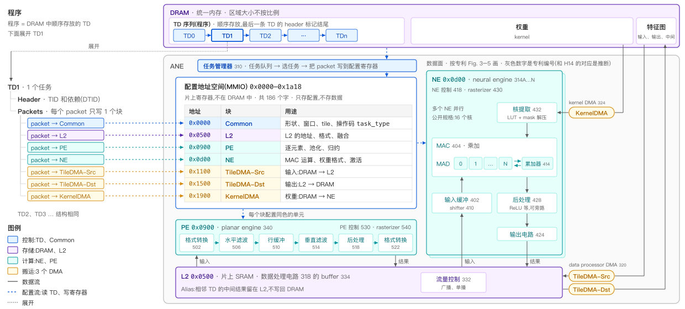
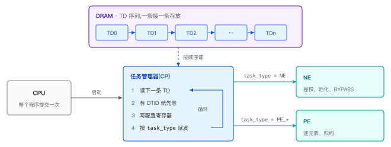

Apple 神经引擎(Apple Neural Engine,ANE)是 Apple 芯片中的神经网络加速器,2017 年随 A11 首次出现。应用通过 Core ML 使用 ANE。本文使用 M2 Pro,它的 ANE 代号是 H14,有 16 个核。Apple 公布的算力是每秒 15.8 万亿次运算,即 [15.8 TOPS](https://www.apple.com/newsroom/2023/01/apple-unveils-m2-pro-and-m2-max-next-generation-chips-for-next-level-workflows/)。A15 的 16 核 ANE 的数字相同,Apple 给出的 fp16 峰值吞吐是 [15.8 TFLOPS](https://machinelearning.apple.com/research/neural-engine-transformers)。ANE 内部有两个计算单元和一块片上 SRAM:NE 做卷积,PE 做逐元素运算、池化和归约。

<!--more-->

```{=html}
<style>
/* 大图按屏幕高度缩放,一屏能看全 */
img.fit-screen { max-height: 85vh; width: auto; justify-self: center; }
</style>
```

## 1. 架构总览

{.column-page .fit-screen fig-align="center"}

DRAM 存放程序[^program]、权重和特征图。ANE 执行程序的步骤:

1. 任务管理器[^tm]从 DRAM 读下一条 TD[^td](图中右上的虚线)。
2. 如果 TD 的 header[^header] 有 DTID[^dtid],任务管理器等待 tid 等于 DTID 的 TD 完成。
3. 任务管理器把每个 packet[^packet] 的值写到配置地址空间[^cfg](图中左侧的虚线)。一个 packet 写一个块[^block]。TD 没有写的字取默认值,不继承上一条 TD。
4. 数据面按配置寄存器的值执行任务(模块和连接来自专利 [US12229657B2](https://patents.google.com/patent/US12229657B2/en) 的实施例,未实测):
    - TileDMA-Src[^tiledma] 把输入从 DRAM 读到 L2[^l2]。
    - KernelDMA[^kdma] 把权重读到 NE[^ne]。
    - NE 和 PE[^pe] 从 L2 读输入,把结果写到 L2。
    - TileDMA-Dst 把输出从 L2 写到 DRAM。
5. 任务管理器读下一条 TD,直到最后一条。最后一条 TD 的 header 有结尾标记。

专利中 NE 和 PE 的内部结构:

| 单元 | 数据经过的模块 |
|------|------|
| NE | 输入缓冲 → MAC(多个 MAD 和一个累加器)→ 后处理 → 输出电路。核提取把 KernelDMA 送来的权重解压,送进 MAD |
| PE | 格式转换 → 水平滤波 → 行缓冲 → 垂直滤波 → 后处理 → 格式转换 |

[^program]: 程序:DRAM 中顺序存放的 TD。
[^tm]: 任务管理器:读 TD、写配置寄存器的单元。名称来自专利。
[^td]: TD(Task Descriptor,任务描述符):ANE 的一条指令。一条 TD 配置一个任务:一层,或一层的一块。
[^header]: header:TD 的头部。内容是 TD 的编号(tid)和依赖(DTID)。
[^dtid]: DTID:一个 tid。有 DTID 的 TD 依赖这个 tid 对应的 TD。
[^packet]: packet:TD 中的一组寄存器写操作。
[^cfg]: 配置地址空间:ANE 片上的配置寄存器,地址是 0x0000–0x1a18,共 186 个字。一个字是 32 位。
[^block]: 块:配置地址空间中的一段,配置一个硬件单元。共 7 个块:Common、L2、PE、NE、TileDMA-Src、TileDMA-Dst、KernelDMA。
[^tiledma]: TileDMA-Src、TileDMA-Dst:搬运特征图的单元。Src 的方向是 DRAM → L2,Dst 的方向是 L2 → DRAM。
[^l2]: L2:片上 SRAM,存放 NE 和 PE 的输入和结果。
[^kdma]: KernelDMA:搬运权重(kernel)的单元,方向是 DRAM → NE。
[^ne]: NE(Neural Engine):计算单元,做卷积。
[^pe]: PE(Planar Engine):计算单元,做逐元素运算、池化、归约。

---

## 2. 指令集

ANE 是寄存器配置型(CSR-configured)加速器:软件写[配置寄存器](https://en.wikipedia.org/wiki/Hardware_register),硬件按配置执行一个任务。[NVDLA](https://nvdla.org/hw/v1/hwarch.html) 和 [Arm Ethos-U](https://pypi.org/project/ethos-u-vela/) 属于同一类。NVDLA 把一次配置和执行称为 [hw-layer](https://nvdla.org/glossary.html),Ethos-U 把这种程序称为命令流(command stream)。

Apple 没有公开 ANE 的指令格式。GitHub 上的项目给出了 TD 和配置寄存器的定义:[eiln/ane](https://github.com/eiln/ane)、[tinygrad](https://github.com/tinygrad/tinygrad/tree/v0.10.3/extra/accel/ane)、[coreml_to_ane_hwx](https://github.com/freedomtan/coreml_to_ane_hwx)、[mil-hwx-compiler](https://github.com/maderix/mil-hwx-compiler)。本文把这些定义汇总成一个文件 `ane_isa.py`。

本文把一条 TD 称为一条指令,把配置寄存器的格式称为指令集。一条 TD 是一组写操作,每个写操作把一个值写到一个配置寄存器地址。写完后,硬件按 `Common.task_type` 启动一个任务。操作码是寄存器字段 `Common.task_type`,TD 的 header 中没有操作码。

{.column-page .fit-screen fig-align="center"}

`ane_isa.py` 用 4 种记录描述指令集。每个事实声明一次,编码器、解码器和反汇编器从记录生成,做法和 LLVM TableGen 相同。

| 记录 | 描述的对象 | 例子 |
|------|------|------|
| `BitField` | 一个字段:值的类型,和位置 `at(地址, 高位, 低位)` | `op: BitField[PEOp, at(0x0900, 4, 2)]` |
| `Block` | 一个块:地址范围,和块中的 `BitField` | `class PE(Block, base=0x0900, end=0x0914)` |
| `Op` | 一种 `task_type`,和它的子操作字段 | `PEBinary(op=PEOp.ADD)` |
| `TD` | 一条 TD:header 和 packet 序列 | `TD.build({...}, tid=1)` |

值的类型有 3 种:`IntEnum`、`float`(16 位字段是 fp16,32 位字段是 fp32)、`int`。`RAW` 标记位置已确定、语义未知的字段。260 个字段中,31 个的语义已验证。

用这些记录构造和解码一条 TD:

```python
td = TD.build({**PEBinary(op=PEOp.ADD), Common.win: 16, Common.hin: 32}, tid=1)
raw = td.to_bytes()                           # 52 字节
assert TD.from_bytes(raw).to_bytes() == raw   # 解码后再编码, 字节相同
```

---

## 3. 运行时



CPU 把整个程序提交给 ANE 一次。任务管理器对每条 TD 执行 4 步,直到最后一条 TD:

1. 按顺序从 DRAM 读一条 TD。
2. 如果 TD 有 DTID,等待 tid 等于 DTID 的 TD 完成。
3. 写配置寄存器。
4. 按 `task_type` 把任务交给 NE 或 PE。

```python
for td in program:              # 按 .hwx 中的顺序
    if td.dtid is not None:     # header 的第 9 个字, 少数 TD 有
        wait(td.dtid)           # 等待 tid == DTID 的 TD 完成
    regs = defaults()           # TD 不写的字取默认值
    for addr, value in td.writes:
        regs[addr] = value
    dispatch(regs)              # task_type 是 NE: 交给 NE; 其他: 交给 PE
    if td.is_last:              # header 的 log_events 有结尾标记
        break
```

`wait` 和 `dispatch` 是从 TD 格式推断的,未在硬件上验证。

**TD 的存放。** TD 在 `.hwx` 中连续存放,16 字节对齐。TD 没有跳转,也没有指向下一条 TD 的指针。本机的 70 个 `.hwx` 中,第一条 TD 的 `log_events` 都是 0x8,最后一条都是 0x22。推断 0x22 是结尾标记。

**DTID。** Apple 自带的 H14S 模型有 2534 条 TD,其中 199 条有 DTID。这 199 条都是 NE 任务,其中 103 条等待的是上一条 TD。例子:

```
tid  task_type     DTID
69   NE BYPASS
70   NE CONV
71   PE_EW_UNARY
72   NE CONV       71     # 等待 TD71 完成
73   NE BYPASS
```

TD72 等待它的上一条 TD71。如果硬件串行执行 TD,这个等待没有作用。推断(未在硬件上验证):NE 和 PE 可以同时工作,没有 DTID 的 TD 不等待前面的 TD 完成。

**提交开销。** 本机实测:模型有一条 TD 时,一次推理最少需要 0.10–0.12 ms。编译器把整个模型的 TD 放在同一个 `.hwx` 中,CPU 提交一次,TD 之间的切换由任务管理器完成。H14S 的 2534 条 TD 在同一个 `.hwx` 中。如果逐条提交,开销约为 2534 × 0.1 ms ≈ 250 ms。

---

## 4. 编译器

### 4.1 一条 TD 的能力

ANE 有两个计算单元:NE 做卷积,PE 做逐元素运算。`task_type` 选择计算单元:`NE` 选 NE,6 种 `PE_*` 选 PE。用 PyTorch 表示:

```python
import torch.nn.functional as F

# NE: 卷积 (task_type = NE)
# NE.op 还可以选 POOL、EW_MUL、EW_SQUARE 和 BYPASS(不计算, 只搬数据)
def ne_conv(x, w, stride=1):
    # x: [cin, hin, win]      cin ≤ 65536, hin ≤ 16384, win ≤ 16384
    # w: [cout, cin, kh, kw]  cout ≤ 65536, kh ≤ 32, kw ≤ 32
    #                         类型 uint8 / int8 / fp16
    # stride: 1 或 2
    return F.conv2d(x, w, stride=stride)

# PE: 逐元素运算, 可以再接一个归约 (task_type = PE_*)
def pe(a, b, op, reduce=None):
    y = op(a, b)              # add / mul / max / min
    if reduce is not None:
        y = reduce(y)         # sum / avg / max / min
    return y
```

张量按 `[通道, 高, 宽]` 存放,宽这一维在内存中连续。`ne_conv` 注释中的参数上限来自编译器 setter 的范围检查。

### 4.2 一个矩阵乘

NE 没有矩阵乘。编译器用 1×1 卷积计算 `C = A @ B`(A 是 M × K,B 是 K × N):

| 矩阵乘 | 1×1 卷积 |
|------|------|
| K | 输入通道 |
| M | 宽 |
| N | 输出通道 |
| B | 权重 |

测试模型是用 coremltools 写的 `C = A @ B`:M = 256,K = N = 2048,fp16,B 是常量。在本机编译,用 `ane_isa.py` 解码,得到 9 条 TD:

::: {.column-page}
+---------------------+----------------------------------------------+
| 标准写法            | ANE 上的写法(9 条 TD)                        |
+=====================+==============================================+
| ```python           | ```python                                    |
| # A: [256, 2048]    | # A: [256, 1, 2048], 在 DRAM                 |
| # B: [2048, 2048]   |                                              |
| C = A @ B           | # TD0: NE BYPASS, 不计算, 只转置             |
| # C: [256, 2048]    | # [2048, 1, 256], 留在 L2                    |
| ```                 | At = A.permute(2, 1, 0)                      |
|                     |                                              |
|                     | # TD1..TD8: NE CONV, 每条算 C 的 256 列      |
|                     | for j in range(8):                           |
|                     |     n = slice(256 * j, 256 * (j + 1))        |
|                     |     # [256, 2048, 1, 1], 1 MiB, 从 DRAM 读   |
|                     |     w = B[:, n].T[:, :, None, None]          |
|                     |     # [256, 1, 256], 128 KiB, 写到 L2        |
|                     |     Ct = ne_conv(At, w)                      |
|                     |     # 转置后写回 DRAM                        |
|                     |     C[:, :, n] = Ct.permute(2, 1, 0)         |
|                     | ```                                          |
+---------------------+----------------------------------------------+
:::

- 形状来自 TD 的 `cin`、`hin`、`win`、`cout`。
- 存储位置来自 TD 写了哪些 DMA 块。TD1–TD8 都不写 TileDMA-Src,输入 `At` 在 L2 中。
- `permute` 对应 `Common.output_transpose`(编译器中的名称)。"转置"这个语义是从前后 TD 的形状推断的。
- 以上来自编译结果,没有在硬件上执行。

### 4.3 两个连续的矩阵乘

`D = (A @ B) @ W`,W 是 2048 × 2048 的常量。编译得到 17 条 TD:

::: {.column-page}
+------------------------+------------------------------------------+
| 标准写法               | ANE 上的写法(17 条 TD)                   |
+========================+==========================================+
| ```python              | ```python                                |
| # A: [256, 2048]       | # A: [256, 1, 2048], 在 DRAM             |
| # B, W: [2048, 2048]   |                                          |
| H = A @ B              | # TD0: NE BYPASS, 只转置                 |
| D = H @ W              | # [2048, 1, 256], 写回 DRAM              |
| # D: [256, 2048]       | At = A.permute(2, 1, 0)                  |
| ```                    |                                          |
|                        | # TD1..TD8: NE CONV, 算 H = A @ B        |
|                        | # TD1 先把 At 从 DRAM 读进 L2            |
|                        | for j in range(8):                       |
|                        |     n = slice(256 * j, 256 * (j + 1))    |
|                        |     w = B[:, n].T[:, :, None, None]      |
|                        |     # [256, 1, 256], 留在 L2, 不转置     |
|                        |     Ht[n] = ne_conv(At, w)               |
|                        |                                          |
|                        | # TD9..TD16: NE CONV, 算 D = H @ W       |
|                        | for j in range(8):                       |
|                        |     p = slice(256 * j, 256 * (j + 1))    |
|                        |     w = W[:, p].T[:, :, None, None]      |
|                        |     # Ht: [2048, 1, 256], 整个从 L2 读   |
|                        |     Dt = ne_conv(Ht, w)                  |
|                        |     # 转置后写回 DRAM                    |
|                        |     D[:, :, p] = Dt.permute(2, 1, 0)     |
|                        | ```                                      |
+------------------------+------------------------------------------+
:::

和 4.2 的区别:

1. H 不写回 DRAM。TD1–TD8 都不写 TileDMA-Dst,8 块 H 存放在 L2 的 0xe0000、0xc0000 … 0x0,每块 128 KiB。TD9–TD16 都不写 TileDMA-Src,从 L2 读 H。
2. H 不转置。`ne_conv` 的输出 `Ht` 是 `[N, 1, M]`,和下一个 `ne_conv` 的输入格式相同。TD1–TD8 的 `output_transpose` 是 0。

L2 中的张量被多条 TD 复用:`At` 被 TD1–TD8 复用,A 从 DRAM 读一次;H 被 TD9–TD16 复用。每条 CONV 更换一块权重。

### 4.4 编译整个模型

编译器对整个模型做下面的工作,输出是 TD 序列:

| 工作 | 内容 |
|------|------------------------|
| 算子映射 | 把每个算子分解成 NE / PE 任务。例子:矩阵乘 → 1×1 CONV(4.2) |
| 布局选择 | 决定每个张量怎样放进 `[通道, 高, 宽]`,减少 BYPASS 转置。H14S 有 699 条 BYPASS、575 条 CONV |
| 分块 | 按 L2 和权重缓冲的大小分块。例子:4.2 中 B 分成 8 块 |
| 融合 | 把相邻算子的中间结果保留在 L2 中,不写回 DRAM。例子:4.3 中的 H |
| L2 分配 | 给保留在 L2 中的张量分配地址。例子:H 的 8 块存放在 0xe0000 … 0x0 |
| 调度与同步 | 决定 TD 的顺序,给需要等待的 TD 加 DTID |
| 常量处理 | 在编译时把权重排成卷积需要的格式,选择 fp16 / int8 |

---

## 5. 使用流程

ANE 通过 Core ML 使用:开发者提供 Core ML 模型,系统把模型编译成 TD 序列并执行。

{.column-page .fit-screen fig-align="center"}

### 5.1 文件格式

`.mlpackage` 中的 `model.mlmodel` 是 protobuf,内容是 MIL 程序。MIL(Model Intermediate Language)是 coremltools 的中间表示。`coremlc` 把它输出成文本格式的 `model.mil`。图中的 `model.mil` 是本机 `coremlc` 对一个 3×3 卷积模型的输出。

`weight.bin` 存放常量的值。文件头是 64 字节,每个常量有 64 字节的常量头(magic 是 0xDEADBEEF)。MIL 中 `BLOBFILE` 的 `offset` 是常量头的位置。

### 5.2 ANE 编译

第 ③ 步的输入是 `model.mil` 和 `weight.bin`,输出是 `model.hwx`。4.4 的工作在这一步完成。Apple 的编译器是私有框架 ANECompiler,没有公开文档。图中的阶段来自 [mil-hwx-compiler](https://github.com/maderix/mil-hwx-compiler) 的 README。它是第 ③ 步的开源实现,不调用 ANECompiler。

和 4.4 的对应关系:分解对应算子映射,结构融合对应融合,SRAM 规划对应 L2 分配。mil-hwx-compiler 的结果来自 M4,本文没有在 H14 上运行它。

4.2 和 4.3 的 TD 来自第 ① 步到第 ③ 步的输出。

### 5.3 加载和执行

第 ④ 步由系统完成:

1. Core ML 请求 `aned` 加载模型。`aned` 是 ANE 的系统守护进程。
2. `aned` 在缓存(`/Library/Caches/com.apple.aned`)中查找 `model.hwx`。如果缓存中没有,`aned` 请求编译服务执行第 ③ 步,把 `model.hwx` 存放在缓存中。
3. `aned` 把 `model.hwx` 交给内核驱动,内核驱动创建程序。
4. 每次推理时,应用用 IOSurface 提供输入和输出,CPU 把整个程序提交一次(见第 3 节)。

模型中 ANE 不支持的算子由 Core ML 放到 CPU 或 GPU 上执行。

步骤 1 到 3 来自 `aned` 的静态分析和 mil-hwx-compiler 的文档,没有动态跟踪。

---

## 参考

- maderix,[Inside the M4 Apple Neural Engine](https://maderix.substack.com/p/inside-the-m4-apple-neural-engine)
- [maderix/mil-hwx-compiler](https://github.com/maderix/mil-hwx-compiler)
- [maderix/ANE](https://github.com/maderix/ANE)
- [apple/coremltools](https://github.com/apple/coremltools)
- [eiln/ane](https://github.com/eiln/ane)
- [freedomtan/coreml_to_ane_hwx](https://github.com/freedomtan/coreml_to_ane_hwx)
- [tinygrad/tinygrad](https://github.com/tinygrad/tinygrad)
- [apple-oss-distributions/xnu](https://github.com/apple-oss-distributions/xnu)
- Apple,[US12229657B2: Multi-mode planar engine for neural processor](https://patents.google.com/patent/US12229657B2/en)
